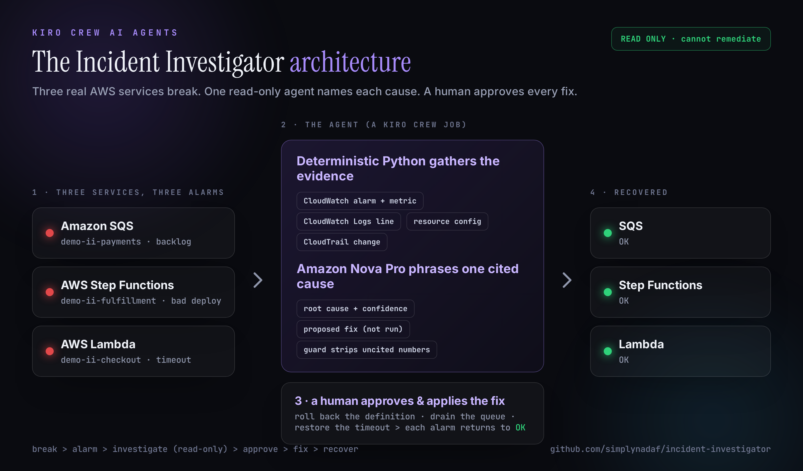
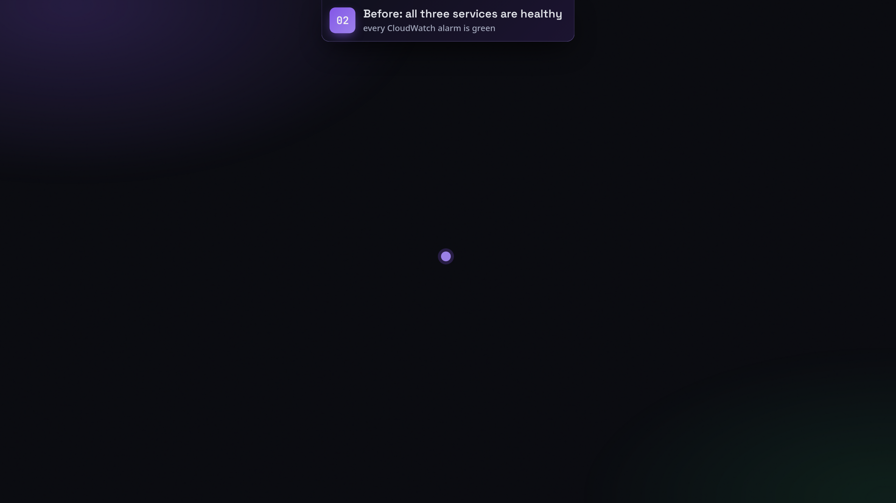
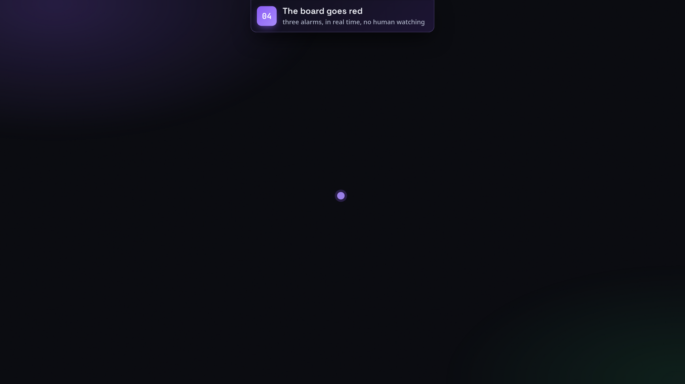
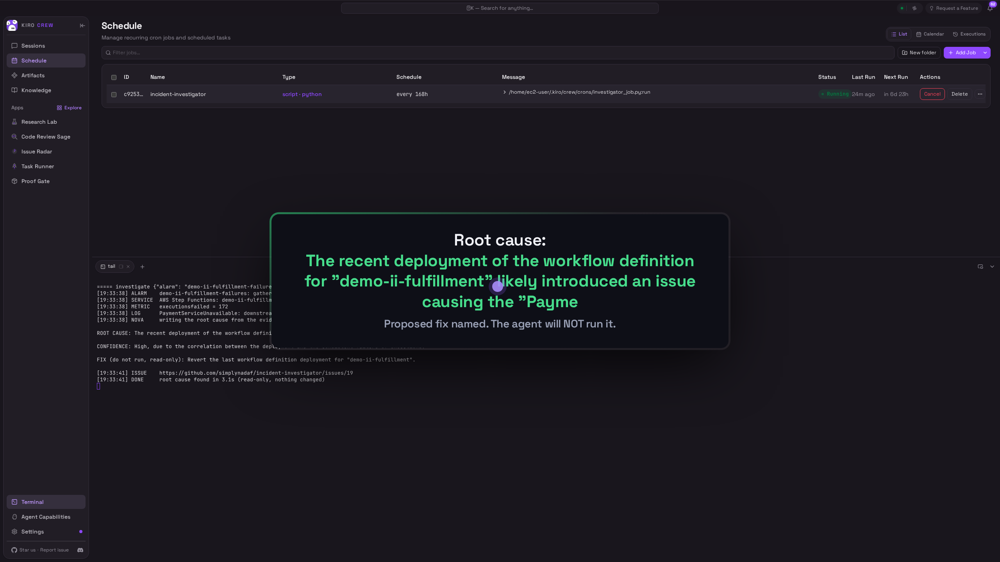
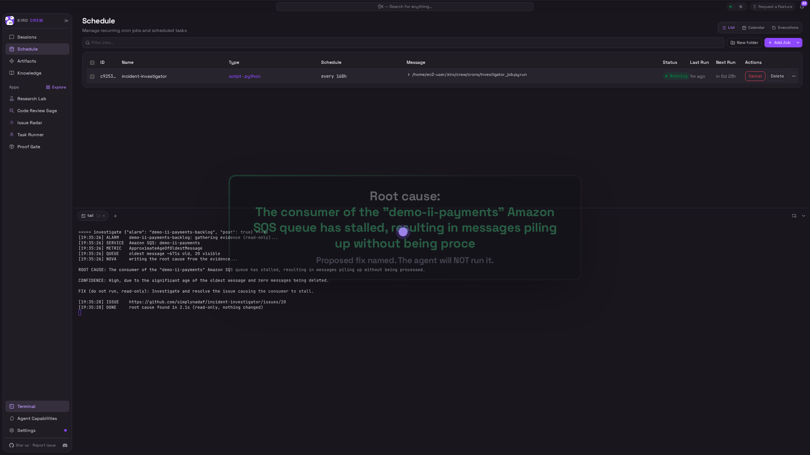
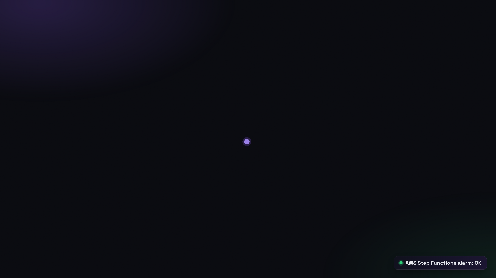
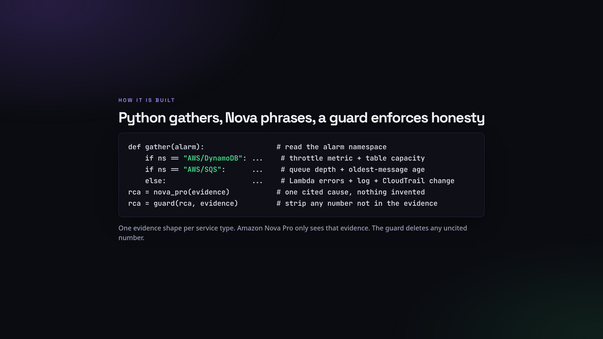

<div align="center">

# 🔍 Incident Investigator: a read-only AI SRE

### Three different production services break at once. A read-only AI agent investigates each one, traces it from the CloudWatch alarm to the metric, to the log or the config, to the change that caused it, and names a single cited root cause plus the fix to run. It never remediates on its own. A human approves each fix, and the alarms recover.

[](https://aws.amazon.com/bedrock/nova/)
[](https://kiro.dev)
[](#-read-only-by-design)
[](#-how-its-built)
[](LICENSE)

> Most AI for incidents makes you faster at correlating signals, not at isolating the cause. This one commits to a single root cause with a confidence level, and tells you what it could not verify.

</div>

---

## 🏗️ Architecture

<div align="center">

</div>

The flow is the same for every incident: **break → alarm → investigate (read-only) → approve → fix → recover.** The agent only ever reads. A human draws the line in production.

---

## 🤔 What it does

An alarm tells you something is wrong, not why. A human SRE then opens five tabs: the alarm, the metric, the logs, the resource config, the deploy history. The Incident Investigator does that walk for you, read-only, across **three different AWS services at once**, names one cited root cause per incident, and proposes the exact fix. A human approves and applies each fix, and the alarm recovers.

The three incidents, each a different service, a different signal, and a different fix:

| # | Service | Incident | What the agent reads | The fix (a human runs) |
|---|---------|----------|----------------------|------------------------|
| 1 | **AWS Step Functions** | a bad definition was deployed, every execution fails | `ExecutionsFailed` metric + the failed execution's error + the CloudTrail `UpdateStateMachine` | roll the definition back |
| 2 | **Amazon SQS** | the consumer stalled, messages pile up (no error anywhere) | `ApproximateAgeOfOldestMessage` + queue depth | drain the backlog / restart the consumer |
| 3 | **AWS Lambda** | a config change cut the timeout from 10s to 1s | the `Errors` metric + the timeout log line + the CloudTrail `UpdateFunctionConfiguration` | restore the timeout |

> The agent investigates. A human draws the line in production. No agent touches prod unsupervised.

---

## 👀 See it in action

**Healthy, then all three break at once.** Three real services, three CloudWatch alarms. Remember the green.

<div align="center">

</div>

A bad workflow deploy, a stalled queue consumer, and a slashed Lambda timeout, in one moment. The board goes red, in real time, with no human watching.

<div align="center">

</div>

**Then the agent solves them one at a time, read-only.** For each incident it reads the alarm, the right metric, the log or the config, and the change that landed just before the spike, then names one cited root cause and the fix a human should run.

<div align="center">

</div>

<div align="center">

</div>

<div align="center">

</div>

**A human approves each fix, and that alarm recovers to OK, one at a time.**

<div align="center">

</div>

---

## 🧠 How it's built

```
 🚨  Three CloudWatch alarms flip to ALARM (SQS, Step Functions, Lambda)
       │
       ▼
 🔎  deterministic Python gathers read-only evidence (boto3: Describe / Get / Filter / Lookup)
       │   one evidence shape per service, picked by the alarm's namespace:
       │     AWS/SQS     -> queue depth + ApproximateAgeOfOldestMessage
       │     AWS/States  -> ExecutionsFailed + the failed execution + CloudTrail UpdateStateMachine
       │     AWS/Lambda  -> Errors + the error log line + config + CloudTrail UpdateFunctionConfiguration
       ▼
 ✍️  Amazon Nova Pro writes ONE root cause + a confidence level + the proposed fix
       │   using only that evidence; a guard strips any number the evidence lacks
       ▼
 📋  posted as a GitHub issue (read-only to AWS; writes only an issue to your repo)
       │
       ▼
 🧑💻  a HUMAN approves and applies the fix  ->  the alarm recovers to OK
```

<div align="center">

</div>

- **`harness/investigate.py`** dispatches on the alarm's namespace to a per-service evidence gatherer (SQS, Step Functions, Lambda), then calls Nova Pro. Read-only to AWS. The guard strips any number not present in the evidence.
- **`infra/setup_3services.sh`** provisions all three healthy services and their alarms.
- **`infra/incidents3.sh`** breaks or fixes one service at a time: `break|fix fulfillment|payments|checkout`.
- **`infra/setup_readonly.sh`** creates the read-only identity and proves a write is denied.
- **`crons/investigator_job.py`** runs it as a Kiro Crew job (the job message is its config).

---

## 🔒 Read-only by design

The agent runs under an identity with `ReadOnlyAccess` plus one narrow permission: `bedrock:InvokeModel` on the Nova model, so it can phrase what it found. It has no permission to change any AWS resource. A write attempt returns `AccessDeniedException`, on camera. It investigates; a human decides and acts.

---

## 🚀 Run it

```bash
git clone https://github.com/simplynadaf/incident-investigator ~/incident-investigator
cd ~/incident-investigator
python3.11 -m venv .venv && .venv/bin/pip install boto3

# 1. provision three healthy services (SQS, Step Functions, Lambda) + their alarms
bash infra/setup_3services.sh
bash infra/setup_readonly.sh          # the read-only identity (proves a write is denied)

# 2. break all three at once; each CloudWatch alarm fires
bash infra/incidents3.sh break fulfillment
bash infra/incidents3.sh break payments
bash infra/incidents3.sh break checkout

# 3. investigate each one, read-only (names a cited cause + the fix, posts a GitHub issue)
AWS_PROFILE=ii-readonly python3 harness/investigate.py --alarm demo-ii-fulfillment-failures --post
AWS_PROFILE=ii-readonly python3 harness/investigate.py --alarm demo-ii-payments-backlog    --post
AWS_PROFILE=ii-readonly python3 harness/investigate.py --alarm demo-ii-checkout-errors      --post

# 4. a human approves + applies each fix; the alarms recover to OK
bash infra/incidents3.sh fix fulfillment
bash infra/incidents3.sh fix payments
bash infra/incidents3.sh fix checkout

# 5. tear it all down
bash infra/teardown_3services.sh
```

Requirements: AWS credentials, a read-only profile (`infra/setup_readonly.sh`), `gh` logged in, and Bedrock access to `amazon.nova-pro-v1:0` in us-east-1.

---

## 🧾 Honest limits

- It finds common classes: a bad deploy, a stalled queue, a starved or timed-out function, a throttle. A novel, first-of-its-kind outage still needs a human.
- Every value it reports comes from your telemetry. The guard strips any number the evidence does not contain.
- It reports the real wall-clock of each run. It does not claim an MTTR figure.
- The incident set here is small and deliberately clean, to make the demo reproducible. The agent voice in the video is a synthetic text-to-speech narration.

---

## 📝 License

MIT. See [LICENSE](LICENSE).

---

<div align="center">

**Sarvar Nadaf** · Cloud Architect · AI Infrastructure & DevOps

[Portfolio](https://sarvarnadaf.com) · [GitHub](https://github.com/simplynadaf) · [LinkedIn](https://www.linkedin.com/in/sarvar04/) · [YouTube](https://www.youtube.com/@sarvar-nadaf)

*The agent investigates. A human decides. Nothing gets remediated by a model.*

</div>
