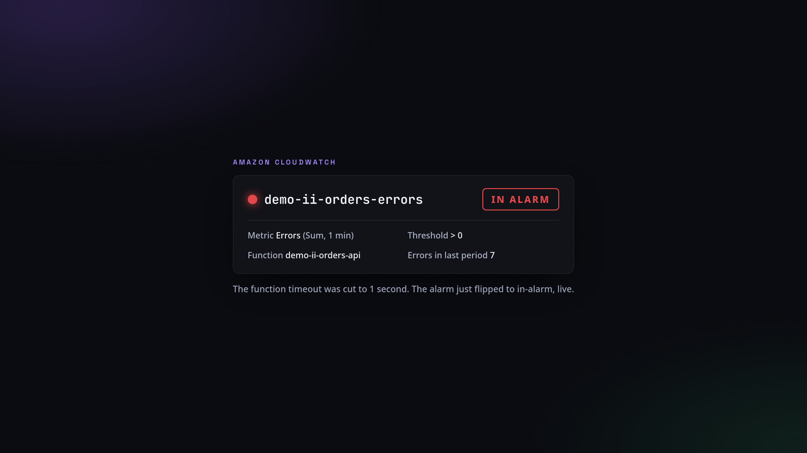
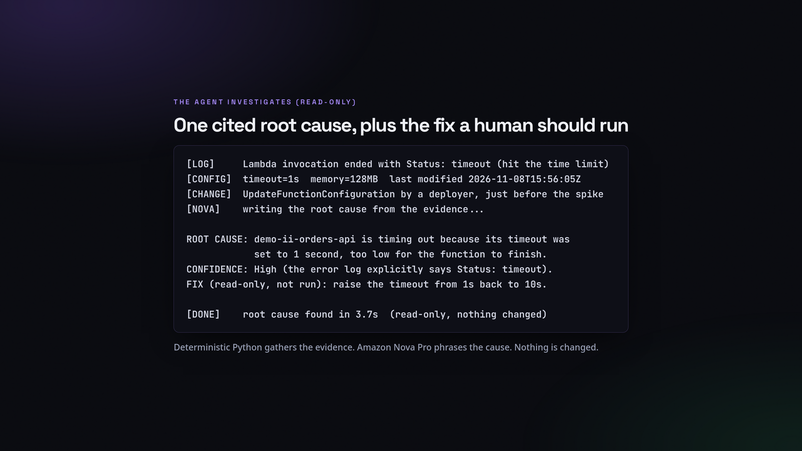
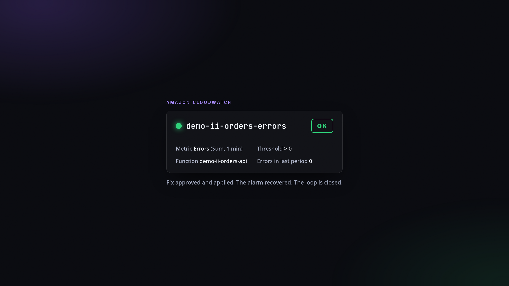

<div align="center">

# 🔍 Incident Investigator: a read-only AI SRE

### A CloudWatch alarm fires. In about a minute, this agent traces it from the alarm, to the metric spike, to the exact error log line, to the change that caused it, and names one cited root cause plus the fix to run. It runs read-only: it investigates and proposes, it never remediates on its own. A human approves the fix, and the alarm recovers. The analysis is posted straight to a GitHub issue.

[](https://aws.amazon.com/bedrock/nova/)
[](https://kiro.dev)
[](#-read-only-by-design)
[](#-how-it-works)
[](LICENSE)

> Most AI for incidents makes you faster at correlating signals, not at isolating the cause. This one commits to a single root cause with a confidence level, and tells you what it could not verify.

</div>

---

## 🤔 What it does

An alarm tells you something is wrong, not why. A human SRE then opens five tabs: the alarm, the metric, the logs, the function config, the deploy history. The Incident Investigator does that walk for you, read-only, names one cited root cause, and proposes the exact fix. Then a human approves and applies it, and the alarm recovers. The whole loop:

1. Prod breaks (a bad config change cuts a Lambda timeout from 10s to 1s).
2. The CloudWatch alarm flips from OK to in-alarm, live.
3. The agent traces alarm to metric to log line to the exact change, and names the cause.
4. It proposes the fix. It does not run it. Read-only.
5. A human approves and applies the fix.
6. The alarm recovers to OK. The loop is closed.

> The agent investigates. A human draws the line in production. No agent touches prod unsupervised.

---

## 👀 See it in action

**Healthy, then broken:** a real orders API on Lambda. A deployer cuts the timeout to 1 second, and the errors alarm flips to in-alarm, live.

<div align="center">

</div>

**The agent investigates, read-only:** it reads the alarm, the error metric, the exact log line, the config, and the change that landed just before the spike, then names one cited root cause and the fix a human should run.

<div align="center">

</div>

**A human approves the fix, and the alarm recovers to OK:**

<div align="center">

</div>

---

## 🧠 How it works

```
 🚨  A CloudWatch alarm on a Lambda function flips to ALARM
       │
       ▼
 🔎  read-only evidence (boto3: Describe / Get / Filter / Lookup)
       │   alarm -> Errors or Throttles spike -> the error log line
       │   -> GetFunctionConfiguration (timeout, memory, concurrency, last modified)
       │   -> CloudTrail: the change that matches the failure (config / code / concurrency)
       ▼
 ✍️  Amazon Nova Pro writes ONE root cause + a confidence level + the proposed fix
       │   using only the evidence; a guard strips any number the evidence lacks
       ▼
 📋  posted as a GitHub issue (read-only to AWS; writes only an issue to your repo)
       │
       ▼
 🧑‍💻  a HUMAN approves and applies the fix  ->  the alarm recovers to OK
```

- **`harness/investigate.py`** gathers the evidence and calls Nova Pro. Read-only to AWS.
- **`infra/incidents.sh`** plants each demo incident and the fix (`timeout | codebug | memory | throttle | heal`).
- **`infra/setup_readonly.sh`** creates the read-only identity and proves a write is denied.
- **`crons/investigator_job.py`** runs it as a Kiro Crew job (the job message is its config).

---

## 🔒 Read-only by design

The agent runs under an identity with `ReadOnlyAccess` plus one narrow permission: `bedrock:InvokeModel` on the Nova model, so it can phrase what it found. It has no permission to change any AWS resource. A write attempt returns `AccessDeniedException`, on camera. It investigates; a human decides and acts.

---

## 🚀 Run it

```bash
git clone https://github.com/simplynadaf/incident-investigator ~/incident-investigator
cd ~/incident-investigator
python3.11 -m venv .venv && .venv/bin/pip install boto3

# plant a demo incident, investigate it read-only, then approve the fix
bash infra/setup_incident.sh          # a healthy orders-API Lambda + an Errors alarm
bash infra/incidents.sh timeout       # break it (cuts the timeout to 1s), the alarm fires
AWS_PROFILE=ii-readonly python3 harness/investigate.py --alarm demo-ii-orders-errors --post
bash infra/incidents.sh heal          # approve + apply the fix, the alarm recovers to OK
```

Requirements: AWS credentials, a read-only profile (`infra/setup_readonly.sh`), `gh` logged in, and Bedrock access to `amazon.nova-pro-v1:0` in us-east-1.

---

## 🧾 Honest limits

- It finds common classes: a config change, a bad deploy, a starved function, a throttle. A novel, first-of-its-kind outage still needs a human.
- Every value it reports comes from your telemetry. The guard strips any number the evidence does not contain.
- It reports the real wall-clock of each run. It does not claim an MTTR figure.
- The incident set here is small and deliberately clean, to make the demo reproducible.

---

## 📝 License

MIT. See [LICENSE](LICENSE).

---

<div align="center">

**Sarvar Nadaf** · Cloud Architect · AI Infrastructure & DevOps

[Portfolio](https://sarvarnadaf.com) · [GitHub](https://github.com/simplynadaf) · [LinkedIn](https://www.linkedin.com/in/sarvar04/) · [YouTube](https://www.youtube.com/@sarvar-nadaf)

*The agent investigates. A human decides. Nothing gets remediated by a model.*

</div>
