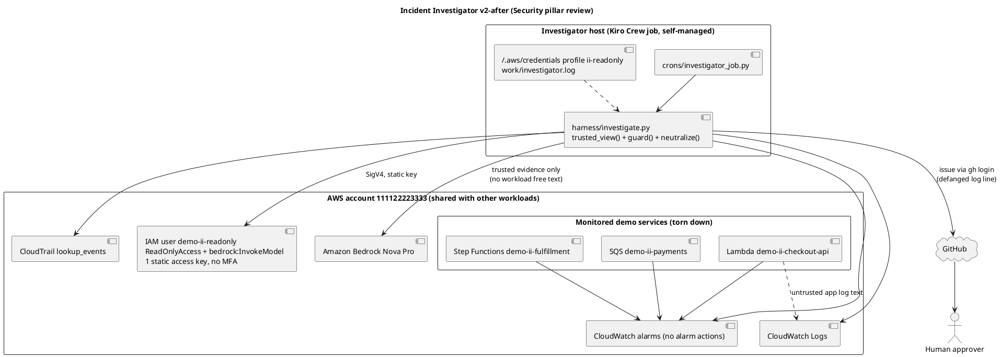

# Well-Architected Review: Incident Investigator v2-after (Security pillar)

> **Classification: CONFIDENTIAL** - This report contains sensitive infrastructure details and unremediated security findings. Restrict distribution to authorized personnel. Do not post to broadly visible channels or ticketing systems without explicit approval.

## Coverage Audit
- Review status: COMPLETE - 52 of 52 in-scope BPs read in full, self-checked and spot-checked
- Run: 20261126T083309Z-r7q2, started 2026-11-26T08:33:09Z - every count in this audit covers this run id only. This is a fresh run: no earlier report, ledger or review artifact was read.
- Review Integrity: no embedded instructions found
- Review mode: pillar-scoped (pillar: Security; 52 BPs). The live index (34791 characters, read 2026-11-26) lists 11 Security questions and 52 Security BPs, which are the in-scope set. The other pillars and the Cloud Foundations section were not inventoried.
- BP pages read: 52 / 52 in scope
- Unreadable BP pages (page_unreadable): none (cap 3; user-accepted degraded run: no)
- Read proof (agent-checked, not machine-verified): 52 rows with end_index == total_length and truncated false copied from the tool response, and two verbatim quotes (opening and tail) · retrieval_method: mcp_read 52, web_fetch 0
- Read proof unverified: none
- Spot-check: 10 pages re-read (fixed sample: the first BP of S01 and of 9 evenly spaced shards; no web_fetch or page_unreadable rows), 10 passed, 0 shards redone; it confirms the sampled quotes are on the page, not every row (agent-checked by the reviewing agent; the sample is fixed by the shard plan and known in advance)
- Framework version source / corpus provenance: https://docs.aws.amazon.com/wellarchitected/latest/framework/toc-contents.json, retrieved 2026-11-26T08:33:30Z, mcp_toc_index, index_total_length 34791 · Pillars 1 (Security), Questions 11, Best practices 52
- Status distribution: Implemented 1, Partially Implemented 25, Not Implemented 8, Not Applicable 10, Cannot Determine 8
- Disclosure on independence: README.md:19-24 and docs/THREAT-MODEL.md:14,24 are in the declared scope and were read as workload documentation. They mention an earlier review and its finding labels (F-01 to F-03) and claim measured results. Those claims were not used as evidence for any status; each row rests on code, scripts, tests or live reads. This run did not execute the tests or the guard (read-only, no programs), so the "15 tests" count comes from reading tests/test_security.py.
- Evidence excluded from this review (stated in advance by the requester): `target/docs/well-architected-review/` and `target/bench/` (earlier review artifacts and benchmark data) and the earlier review in `../review/`. The test fixtures under bench/evidence were not used as evidence of workload behaviour.
- Evidence ledger: ./review-after/aws-well-architected-review-ledger/ - 13 shard files, 52 rows (one per in-scope BP: URL, retrieval_method, read proof, verbatim opening and tail quotes, status, evidence), spot-check.md
- Live reads made (read-only): sts get-caller-identity, iam get-user/list-mfa-devices/list-attached-user-policies/list-user-policies/get-user-policy/list-access-keys/get-account-summary/get-account-password-policy/list-roles, cloudwatch describe-alarms, cloudtrail describe-trails, accessanalyzer list-analyzers, inspector2 batch-get-account-status, guardduty list-detectors, logs describe-log-groups. No AWS write API was called. The demo-ii-* alarms, queue and function were already torn down.

## Executive Summary
- **Date**: 2026-11-26
- **Workload**: Incident Investigator (read-only AI SRE), tag v2-after (commit 46a5056)
- **Business Criticality**: standard
- **Lens Applied**: General
- **Packages Analyzed**: README.md, harness/investigate.py, crons/investigator_job.py, infra/*.sh, tests/test_security.py, docs/THREAT-MODEL.md, .github/workflows/ci.yml, .gitignore
- **Questions Assessed**: 11/11 (Security)
- **Findings**: 0 Critical, 1 High, 7 Medium, 11 Low
- **Overall Maturity**: 3 - application-level handling of untrusted log text is strong and tested, the model grant is tightly scoped and nothing can write to AWS, but the machine identity is a long-lived static key and nothing scans, alerts on or reviews the tool itself.

## Architecture Overview

A cron job on a self-managed host runs `harness/investigate.py` under the IAM user `demo-ii-readonly` (static key in a local profile). It reads a CloudWatch alarm, metrics, logs, resource config and CloudTrail, sends only trusted evidence plus one allowlisted error type to Amazon Nova Pro, passes the answer through a fail-closed guard, and posts a GitHub issue with the log line defanged. A human applies any fix. The trust boundary that matters is the application log text a monitored workload can write.

## Pillar Scorecard
| Pillar | Score (1-5) | Questions Assessed | Key Strength | Key Gap |
| -------- | ------------- | ------------------- | -------------- | --------- |
| Security | 3 | 11/11 | Untrusted log text never reaches the model; fail-closed guard; 15 security tests run on every push; nothing can write to AWS | Long-lived static access key as the machine identity; no scanning, alerting or detection around the tool; secrets in log text are posted unredacted |

## Per-Question Assessment
| ID | Question | Status | Risk | Key Evidence |
|---|---|---|---|---|
| SEC01 | Securely operate your workload | Partially Implemented | Medium | 0 I / 6 PI / 0 NI / 0 NA / 1 CD; worst SEC01-BP06 (STRIDE model covers one data path) |
| SEC02 | Identity management | Partially Implemented | High | 0 I / 3 PI / 2 NI / 0 NA / 0 CD; worst SEC02-BP02 (static IAM key for a machine identity) |
| SEC03 | Permissions management | Partially Implemented | Medium | 0 I / 1 PI / 1 NI / 3 NA / 0 CD; worst SEC03-BP01 (ReadOnlyAccess account-wide) |
| SEC04 | Detection | Partially Implemented | Medium | 0 I / 2 PI / 0 NI / 0 NA / 0 CD; worst SEC04-BP01, SEC04-BP02 |
| SEC05 | Protecting networks | Not Applicable | - | 0 I / 0 PI / 0 NI / 4 NA / 0 CD; no VPC or endpoint |
| SEC06 | Protecting compute | Partially Implemented | Medium | 0 I / 1 PI / 3 NI / 0 NA / 1 CD; worst SEC06-BP01 (no scanning) |
| SEC07 | Data classification | Partially Implemented | Medium | 0 I / 3 PI / 1 NI / 0 NA / 0 CD; worst SEC07-BP01, SEC07-BP02 |
| SEC08 | Protecting data at rest | Partially Implemented | Low | 0 I / 2 PI / 0 NI / 2 NA / 0 CD; worst SEC08-BP02, SEC08-BP04 |
| SEC09 | Protecting data in transit | Partially Implemented | Low | 1 I / 1 PI / 0 NI / 1 NA / 0 CD; worst SEC09-BP03 |
| SEC10 | Incident response | Partially Implemented | Low | 0 I / 2 PI / 0 NI / 0 NA / 3 CD; worst SEC10-BP03, SEC10-BP04 |
| SEC11 | Application security | Partially Implemented | Medium | 0 I / 4 PI / 1 NI / 0 NA / 3 CD; worst SEC11-BP02, -BP03, -BP06, -BP07 |

## BP Ledger (compact: every in-scope BP)
| BP ID | Status | Risk |
|---|---|---|
| SEC01-BP01 | Partially Implemented | Low |
| SEC01-BP02 | Partially Implemented | Low |
| SEC01-BP03 | Partially Implemented | Low |
| SEC01-BP04 | Partially Implemented | Low |
| SEC01-BP05 | Partially Implemented | Low |
| SEC01-BP06 | Partially Implemented | Medium |
| SEC01-BP07 | Cannot Determine | - |
| SEC02-BP01 | Partially Implemented | Low |
| SEC02-BP02 | Not Implemented | High |
| SEC02-BP03 | Partially Implemented | Medium |
| SEC02-BP04 | Not Implemented | Medium |
| SEC02-BP05 | Partially Implemented | Medium |
| SEC03-BP01 | Partially Implemented | Medium |
| SEC03-BP02 | Not Applicable | - |
| SEC03-BP03 | Not Implemented | Low |
| SEC03-BP04 | Not Applicable | - |
| SEC03-BP05 | Not Applicable | - |
| SEC04-BP01 | Partially Implemented | Medium |
| SEC04-BP02 | Partially Implemented | Medium |
| SEC05-BP01 | Not Applicable | - |
| SEC05-BP02 | Not Applicable | - |
| SEC05-BP03 | Not Applicable | - |
| SEC05-BP04 | Not Applicable | - |
| SEC06-BP01 | Not Implemented | Medium |
| SEC06-BP02 | Cannot Determine | - |
| SEC06-BP03 | Partially Implemented | Low |
| SEC06-BP04 | Not Implemented | Low |
| SEC06-BP05 | Not Implemented | Low |
| SEC07-BP01 | Partially Implemented | Medium |
| SEC07-BP02 | Partially Implemented | Medium |
| SEC07-BP03 | Not Implemented | Low |
| SEC07-BP04 | Partially Implemented | Low |
| SEC08-BP01 | Not Applicable | - |
| SEC08-BP02 | Partially Implemented | Low |
| SEC08-BP03 | Not Applicable | - |
| SEC08-BP04 | Partially Implemented | Low |
| SEC09-BP01 | Not Applicable | - |
| SEC09-BP02 | Implemented | - |
| SEC09-BP03 | Partially Implemented | Low |
| SEC10-BP01 | Cannot Determine | - |
| SEC10-BP02 | Cannot Determine | - |
| SEC10-BP03 | Partially Implemented | Low |
| SEC10-BP04 | Partially Implemented | Low |
| SEC10-BP05 | Cannot Determine | - |
| SEC11-BP01 | Cannot Determine | - |
| SEC11-BP02 | Partially Implemented | Medium |
| SEC11-BP03 | Partially Implemented | Medium |
| SEC11-BP04 | Cannot Determine | - |
| SEC11-BP05 | Cannot Determine | - |
| SEC11-BP06 | Not Implemented | Medium |
| SEC11-BP07 | Partially Implemented | Medium |
| SEC11-BP08 | Partially Implemented | Low |

Evidence ledger: `./review-after/aws-well-architected-review-ledger/` (13 shard files, `spot-check.md`)

## Critical and High Risk Findings

### F-01 (High, Security) Long-lived static IAM access key is the investigator's machine identity
- **Impact / Likelihood**: Impact Severe, Likelihood Medium.
- **Description**: The investigator runs as IAM user `demo-ii-readonly` with one Active static access key (created 2026-11-07), stored in a plaintext profile, with no MFA device and no rotation interval. The key carries `ReadOnlyAccess` plus `bedrock:InvokeModel`, so a leak exposes read access to the whole account, including other workloads' logs and configuration.
- **BP text (SEC02-BP02 anti-pattern)**: "Teams use long-term access keys for machine identities in cases where temporary credentials would work." Desired outcome: "Your machine identities obtain short-lived credentials from assigned roles instead of embedded static keys."
- **Evidence**: infra/setup_readonly.sh:9-24 (create-user, create-access-key, `aws configure set`); crons/investigator_job.py:25 (`AWS_PROFILE=ii-readonly`); [Verified live] list-access-keys shows 1 Active key, list-mfa-devices empty, no account password policy.
- **Related rows**: SEC02-BP03 (key in plaintext profile), SEC02-BP04 (no central provider or role), SEC02-BP05 (rotation is a manual rerun).
- **Recommendation**: Run the job under an IAM role (instance profile or ECS/Lambda role) with a scoped policy, delete the IAM user and key, and alarm on any remaining key use.
- **Effort**: Low to medium (a day). **AWS services**: IAM roles, EC2 instance profile or ECS task role, CloudTrail.

## Medium Risk Findings

- **F-02 Secrets or PII in workload log text are printed and posted unredacted** (SEC07-BP02, SEC07-BP01, SEC04-BP01; Impact Moderate, Likelihood Medium). The code keeps workload free text out of the model (harness/investigate.py:259-266) and defangs it for display (:269-279), but the same text is printed and posted to a GitHub issue (:343, :383) in a repo whose visibility is never checked (:370); docs/THREAT-MODEL.md:14,24 lists redaction as open. SEC04-BP01 anti-pattern: "Sensitive data such as credentials or personal information lands in logs unmasked." Fix: redact credential and PII patterns before display and post, and refuse a public repo.
- **F-03 No vulnerability scanning and unpinned public dependencies** (SEC06-BP01, SEC11-BP06; Impact Moderate, Likelihood Low). Inspector is DISABLED and GuardDuty has no detector [Verified live]; .github/workflows/ci.yml:13 and README.md:134 run `pip install boto3` from PyPI with no lockfile or hashes. SEC11-BP06 anti-pattern: "Developers pull dependencies straight from public repositories, tying their ability to build to the availability and integrity of those repositories." A tampered release would run with the investigator's AWS credentials. Fix: requirements with hashes, pip-audit or Dependabot, Inspector code security.
- **F-04 Untrusted-input controls are tested but not backed by a written standard or SAST/SCA** (SEC11-BP02, SEC11-BP03; Impact Moderate, Likelihood Low). The allowlist, defang and fail-closed guard are strong (harness/investigate.py:249-333) and 15 tests run on every push (.github/workflows/ci.yml:2,14; tests/test_security.py), but no OWASP/CWE mapping or SAST step exists. SEC11-BP02 anti-pattern: "Teams rely on security tools alone and never establish written coding standards." Fix: a one-page secure-coding note for LLM-with-untrusted-input and a SAST/SCA step in CI.
- **F-05 ReadOnlyAccess is account-wide where about 12 read actions are used** (SEC03-BP01; Impact Moderate, Likelihood Medium). The inline policy `ii-bedrock-invoke` is tightly scoped to one model ARN [Verified live], but infra/setup_readonly.sh:13 attaches the AWS-managed `ReadOnlyAccess`. SEC03-BP01 anti-pattern: "Services deploy with broad permissions rather than function-specific access." Fix: a custom policy limited to the read actions harness/investigate.py calls, generated with Access Analyzer policy generation.
- **F-06 Alarms notify nobody, and nothing watches the investigator, its key or the trail** (SEC04-BP02, SEC04-BP01; Impact Moderate, Likelihood Medium). infra/setup_3services.sh:38-42,51-55,76-80 create alarms with no `--alarm-actions`; the CloudTrail trail demo-aa-trail has LogFileValidation false and no KMS key [Verified live]. SEC04-BP02 anti-pattern: "Teams build dashboards and then never act on what the metrics reveal." Fix: alarm actions to an encrypted SNS topic, alarms on investigator failures and on StopLogging/UpdateTrail and use of the key, trail validation and KMS.
- **F-07 Threat model covers one data path with no prioritization, owners or revisit trigger** (SEC01-BP06; Impact Moderate, Likelihood Low). docs/THREAT-MODEL.md:3-16 is a real STRIDE table with a trust rule and residual risk (:18-24), but covers only log text to model to issue; the IAM key, Bedrock and GitHub writes are named only as open items. SEC01-BP06 anti-pattern: "Threats are identified but never prioritized, so limited resources are spent without focus." Fix: extend to the whole system, rank threats, name owners, revisit on each change to investigate.py.
- **F-08 Investigator is deployed by hand from a git clone** (SEC11-BP07; Impact Moderate, Likelihood Medium). README.md:132-157 has an operator run the scripts; crons/investigator_job.py:19-22 runs the checked-out file in place; there is no signature, pipeline or IaC. SEC11-BP07 anti-pattern: "Teams deploy software to production manually." Fix: package as a Lambda or container built in CI, signed, and deployed by pipeline.

## Low Risk Findings
| ID | Pillar | Title | Recommendation |
|---|---|---|---|
| L-01 | Security | Investigator shares account 111122223333 with unrelated workloads (SEC01-BP01) | Move the investigator and its demo services to a dedicated account |
| L-02 | Security | No managed control set or threat-intelligence intake (SEC01-BP02, SEC01-BP03) | Enable Security Hub CSPM with the FSBP standard, GuardDuty, Inspector; add Dependabot |
| L-03 | Security | Investigator runs on a self-managed host (SEC01-BP04) | Package as Lambda or ECS so the provider patches it |
| L-04 | Security | Controls applied by CLI scripts by hand; CI actions pinned by tag; no review cadence (SEC01-BP05, SEC11-BP08, SEC06-BP03) | Express controls as IaC, pin actions to commit SHAs, add CODEOWNERS |
| L-05 | Security | No inventory of principals (SEC02-BP01) | List the IAM identity, gh login, cron job and approver in THREAT-MODEL.md |
| L-06 | Security | No IAM Access Analyzer (SEC03-BP03) | Enable the external-access analyzer and route findings |
| L-07 | Security | No code signing, hash pinning or automated compute protection (SEC06-BP04, SEC06-BP05) | Hash-pinned lockfile, AWS Signer, Patch Manager |
| L-08 | Security | No sensitive-data detection before posting; no log retention (SEC07-BP03, SEC07-BP04) | Detect secrets/PII before posting; set retention on log groups |
| L-09 | Security | Plaintext host files and unencrypted trail; no access review (SEC08-BP02, SEC08-BP04) | EBS default encryption, KMS on trail and logs, quarterly access review |
| L-10 | Security | GitHub writes use the operator's personal gh login (SEC09-BP03) | A dedicated GitHub App or fine-grained token limited to issues on one repo |
| L-11 | Security | No playbooks or simulations for security events on the tool (SEC10-BP03, SEC10-BP04) | Playbooks for key exposure and a poisoned log line; a quarterly tabletop |

## Cross-Pillar Trade-offs
Not applicable to this pillar-scoped review. One interaction inside Security is worth noting: tightening the GitHub issue (redaction, F-02) reduces the evidence a human reads, so keep the raw line on the host log (encrypted, with retention) and post only the redacted form.

## Prioritize Improvements - Eisenhower Matrix

        HIGH IMPORTANCE
             |
   +---------+---------+
   |  DO     |  PLAN   |
   |  FIRST  |         |
---+---------+---------+---
   |DELEGATE |  DEFER  |
   +---------+---------+
             |
        LOW IMPORTANCE
   LOW EFFORT    HIGH EFFORT

| Quadrant | Action | Findings |
| ---------- | -------- | ---------- |
| **Do First** (High Importance, Low Effort) | Implement immediately | F-01, F-02, F-03, F-05 |
| **Plan** (High Importance, High Effort) | Schedule in roadmap, break into phases | F-04, F-06, F-07, F-08 |
| **Delegate** (Low Importance, Low Effort) | Batch together, assign to available team member | L-02, L-04, L-05, L-06, L-08, L-09, L-10, L-11 |
| **Defer** (Low Importance, High Effort) | Revisit in next iteration | L-01, L-03, L-07 |

### Solution Characteristics
- **F-01**: SMART goal: no static access key exists for the investigator within 1 week (list-access-keys returns none for demo-ii-readonly). Owner: workload owner. Simple option: an instance profile.
- **F-02**: within 2 weeks, a redaction function runs over every log line before print or post, with tests for AKIA keys, bearer tokens and emails. Owner: workload owner. Two-way door: pattern list in one place.
- **F-03**: within 1 week, requirements.txt with hashes and pip-audit in ci.yml, failing on high severity. Owner: workload owner.
- **F-05**: within 2 weeks, ReadOnlyAccess replaced by a custom policy of the read actions in harness/investigate.py, verified by running the three incident drills.

## Prioritized Remediation Plan

### Quick Wins (< 1 week) - "Do First" quadrant
| Finding | Action | SMART Goal | Owner Suggestion | Effort |
| --------- | -------- | ----------- | ----------------- | -------- |
| F-01 | Replace the IAM user key with a role | Zero static keys for the investigator by 2026-12-03 | Workload owner | 1 day |
| F-03 | Hash-pinned requirements, pip-audit in CI | CI fails on a known-vulnerable dependency by 2026-12-03 | Workload owner | 0.5 day |

### Foundation (1-4 weeks) - "Plan" quadrant
| Finding | Action | Phases | Effort | Dependencies |
| --------- | -------- | -------- | -------- | -------------- |
| F-02 | Redact before print/post; check repo visibility | 1) pattern set and tests 2) wire into neutralize path | 3 days | none |
| F-05 | Custom least-privilege policy | 1) generate from CloudTrail 2) swap and rerun drills | 2 days | F-01 |
| F-06 | Alarm actions and security alarms | 1) SNS topic 2) alarms on investigator, key, trail | 3 days | none |

### Strategic (1-3 months) - "Plan" quadrant (complex)
| Finding | Action | Phases | Effort | Dependencies |
| --------- | -------- | -------- | -------- | -------------- |
| F-08 | Package, sign and deploy by pipeline | 1) container or Lambda 2) CI build 3) sign and deploy | 2 weeks | F-01, F-03 |
| F-04, F-07 | Written secure-coding note, SAST in CI, extended threat model | iterate | 1 week | none |

### Delegate (batch and assign) - "Delegate" quadrant
| Finding | Action | Owner Suggestion | Effort |
| --------- | -------- | ----------------- | -------- |
| L-02, L-06, L-08, L-09 | Enable Security Hub CSPM, GuardDuty, Inspector, Access Analyzer; set retention and KMS | Any engineer | 1 day |
| L-04, L-05, L-10, L-11 | Pin actions, CODEOWNERS, principal inventory, dedicated GitHub token, two playbooks | Any engineer | 2 days |

### Deferred - Revisit Next Iteration
L-01 (dedicated account), L-03 (move off the self-managed host) and L-07 (signing) wait until the investigator is packaged (F-08).

## Next Steps
1. Replace the `demo-ii-readonly` static key with an IAM role and delete the user (F-01).
2. Add redaction of credentials and PII to every log line before it is printed or posted, and refuse public target repos (F-02).
3. Add a hashed requirements file and pip-audit to .github/workflows/ci.yml (F-03).
4. Replace `ReadOnlyAccess` with a custom policy of the read actions the code uses (F-05).
5. Attach an encrypted SNS topic to the alarms and add alarms on the investigator, the key and the CloudTrail trail (F-06).

Would you like me to:

- Deep-dive into a specific pillar with expanded analysis?
- Generate IaC templates to remediate a specific finding?
- Create a migration plan for a specific architectural change?
- Compare your workload against a specific WA Lens in detail?
- Turn these findings into guardrails (Config rules, alarms, permissions boundaries, SCPs, cfn-guard or CDK checks) that I deploy after you confirm and then test?
- Produce a WA Tool import for tracking in the AWS console?
