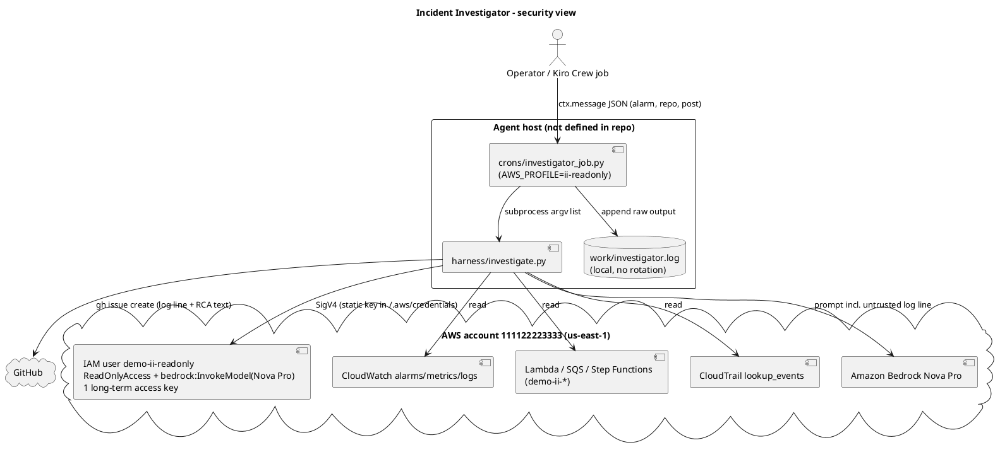

# Well-Architected Review: Incident Investigator (read-only AI SRE), Security pillar

> **Classification: CONFIDENTIAL** - This report contains sensitive infrastructure details and unremediated security findings. Restrict distribution to authorized personnel. Do not post to broadly visible channels or ticketing systems without explicit approval.

## Coverage Audit
- Review status: COMPLETE - 52 of 52 in-scope BPs read in full, self-checked and spot-checked
- Run: 20261126T044842Z-h7q2, started 2026-11-26T04:48:42Z - every count in this audit covers this run id only
- Review Integrity: no embedded instructions found (scanned README.md, harness/investigate.py, crons/investigator_job.py, infra/*.sh, git history subjects; the README's agent descriptions are product text, not directives to a reviewer)
- Review mode: pillar-scoped (pillar: Security; 52 of 216 BPs across the six workload pillars; the 45 FND BPs under Cloud Foundations are not a pillar and not in scope)
- BP pages read: 52 / 52 in scope (pages read in this run's own shards)
- Unreadable BP pages (page_unreadable): none (cap 3; user-accepted degraded run: no)
- Read proof (agent-checked, not machine-verified): 52 rows with end_index == total_length and truncated false copied from the tool response, and two verbatim quotes (opening and tail) - retrieval_method: mcp_read 52, web_fetch 0
- Read proof unverified: none
- Spot-check: 10 pages re-read (fixed sample: first BP of S01 and of 9 evenly spaced shards; no web_fetch or unreadable rows exist), 10 passed, 0 shards redone; it confirms the sampled quotes are on the page, not every row (agent-checked; the sample is fixed by the shard plan and known in advance)
- Framework version source: https://docs.aws.amazon.com/wellarchitected/latest/framework/toc-contents.json, read 2026-11-26 with aws___read_documentation in 2 slices (total_length 34791), retrieval_method mcp_toc_index. The live index has no node titled "Appendix": the six pillars are direct children of "Cloud Workloads" and there is no Category level, so the pillar node was found structurally (appendix_match: structure).
- Pillars, Questions, Best practices: Security 11 questions, 52 BPs (all six pillars enumerated: OPS 28, SEC 52, REL 63, PERF 26, COST 33, SUS 14 = 216)
- Status distribution: Implemented 3, Partially Implemented 22, Not Implemented 7, Not Applicable 11, Cannot Determine 9 (counted from the progress file and re-counted from the shard files)
- Evidence ledger: ./review/aws-well-architected-review-ledger/ - 13 shard files, 52 rows (URL, retrieval_method, read proof, verbatim opening and tail quotes, status, evidence), spot-check.md
- Read-only scope: no AWS write API was called and nothing under target/ was changed (git status of target/ is clean). Live reads used: IAM get/list/simulate, CloudWatch describe-alarms, CloudTrail describe-trails, Access Analyzer list-analyzers, SQS get-queue-url.

## Executive Summary
- **Date**: 2026-11-26
- **Workload**: Incident Investigator, a read-only AI SRE (AWS Lambda, Amazon SQS, AWS Step Functions, CloudWatch alarms, CloudTrail lookups, IAM read-only user, Amazon Bedrock Nova Pro)
- **Business Criticality**: standard (a demo and tool that reads production alarms and logs)
- **Lens Applied**: General
- **Packages Analyzed**: ./target (harness/investigate.py, crons/investigator_job.py, infra/*.sh, README.md)
- **Questions Assessed**: 11/11 (Security)
- **Findings**: 0 Critical, 3 High, 5 Medium, 3 Low (11 findings built from 29 BP gap rows: 3 High, 14 Medium, 12 Low)
- **Overall Maturity**: 2 of 5 - the design is sound (serverless, TLS everywhere, a read-only identity whose write denial is proven, a Bedrock grant scoped to one model ARN) but three controls the README leans on are missing: temporary credentials, data classification and redaction before data leaves the account, and a threat model for the log-to-LLM-to-GitHub path.

Strengths worth keeping: the machine identity cannot change anything (live simulation: lambda:UpdateFunctionConfiguration is implicitDeny), the Bedrock grant names one model ARN, only managed services run (no OS to patch), there is no secret in the repo or its five commits, output is opt-in (`--post`), and each RCA becomes a durable blameless record.

## Architecture Overview

A Kiro Crew job runs `investigate.py` under the `ii-readonly` profile. The harness reads an alarm, its metrics, the failing function's log line and config, and a CloudTrail change, asks Nova Pro for one root cause, filters the answer with a numeric guard, and can post the result as a GitHub issue. Trust boundary: the log line and Step Functions error cause are written by monitored workloads, so they are untrusted input to the LLM and to the issue body. The demo-ii alarms, queue and function were already torn down when this review ran (live describe-alarms returned an empty list), so findings rest on the scripts and on the live IAM identity.

## Pillar Scorecard
| Pillar | Score (1-5) | Questions Assessed | Key Strength | Key Gap |
| -------- | ------------- | ------------------- | -------------- | --------- |
| Security | 2 | 11/11 | Read-only identity with proven write denial; Bedrock grant scoped to one model; only managed services | Long-term access key, no data classification or redaction before data leaves the account, no threat model |

## Per-Question Assessment
| ID | Question | Status | Risk | Key Evidence |
| --- | --- | --- | --- | --- |
| SEC01 | Securely operate your workload | Partially Implemented | High | I1 PI2 NI2 NA0 CD2; worst SEC01-BP06 (no threat model) |
| SEC02 | Identity management | Partially Implemented | High | I0 PI4 NI1 NA0 CD0; worst SEC02-BP02 (long-term key) |
| SEC03 | Permissions management | Partially Implemented | Medium | I0 PI2 NI0 NA3 CD0; worst SEC03-BP01 (ReadOnlyAccess) |
| SEC04 | Detection | Partially Implemented | Medium | I0 PI2 NI0 NA0 CD0; SEC04-BP01 and BP02 |
| SEC05 | Protecting networks | Cannot Determine | - | I0 PI0 NI0 NA3 CD1; serverless, no network tier |
| SEC06 | Protecting compute | Partially Implemented | Medium | I1 PI3 NI0 NA1 CD0; worst SEC06-BP01 (no scanning) |
| SEC07 | Data classification | Partially Implemented | High | I0 PI2 NI1 NA0 CD1; worst SEC07-BP01 (no classification) |
| SEC08 | Protecting data at rest | Partially Implemented | Low | I0 PI1 NI0 NA2 CD1; SEC08-BP04 |
| SEC09 | Protecting data in transit | Partially Implemented | Low | I1 PI1 NI0 NA1 CD0; SEC09-BP03 |
| SEC10 | Incident response | Partially Implemented | Medium | I0 PI3 NI1 NA0 CD1; worst SEC10-BP01 (no contacts) |
| SEC11 | Application security | Partially Implemented | Medium | I0 PI2 NI2 NA1 CD3; worst SEC11-BP02, BP03 |

## BP Ledger (compact: every in-scope BP)
| BP ID | Status | Risk |
| --- | --- | --- |
| SEC01-BP01 | Partially Implemented | Low |
| SEC01-BP02 | Not Implemented | Medium |
| SEC01-BP03 | Cannot Determine | - |
| SEC01-BP04 | Implemented | - |
| SEC01-BP05 | Partially Implemented | Medium |
| SEC01-BP06 | Not Implemented | High |
| SEC01-BP07 | Cannot Determine | - |
| SEC02-BP01 | Partially Implemented | Low |
| SEC02-BP02 | Not Implemented | High |
| SEC02-BP03 | Partially Implemented | Medium |
| SEC02-BP04 | Partially Implemented | Low |
| SEC02-BP05 | Partially Implemented | Medium |
| SEC03-BP01 | Partially Implemented | Medium |
| SEC03-BP02 | Not Applicable | - |
| SEC03-BP03 | Partially Implemented | Low |
| SEC03-BP04 | Not Applicable | - |
| SEC03-BP05 | Not Applicable | - |
| SEC04-BP01 | Partially Implemented | Medium |
| SEC04-BP02 | Partially Implemented | Medium |
| SEC05-BP01 | Not Applicable | - |
| SEC05-BP02 | Cannot Determine | - |
| SEC05-BP03 | Not Applicable | - |
| SEC05-BP04 | Not Applicable | - |
| SEC06-BP01 | Partially Implemented | Medium |
| SEC06-BP02 | Not Applicable | - |
| SEC06-BP03 | Implemented | - |
| SEC06-BP04 | Partially Implemented | Low |
| SEC06-BP05 | Partially Implemented | Low |
| SEC07-BP01 | Not Implemented | High |
| SEC07-BP02 | Partially Implemented | Medium |
| SEC07-BP03 | Cannot Determine | - |
| SEC07-BP04 | Partially Implemented | Medium |
| SEC08-BP01 | Not Applicable | - |
| SEC08-BP02 | Cannot Determine | - |
| SEC08-BP03 | Not Applicable | - |
| SEC08-BP04 | Partially Implemented | Low |
| SEC09-BP01 | Not Applicable | - |
| SEC09-BP02 | Implemented | - |
| SEC09-BP03 | Partially Implemented | Low |
| SEC10-BP01 | Not Implemented | Medium |
| SEC10-BP02 | Partially Implemented | Medium |
| SEC10-BP03 | Partially Implemented | Low |
| SEC10-BP04 | Cannot Determine | - |
| SEC10-BP05 | Partially Implemented | Low |
| SEC11-BP01 | Cannot Determine | - |
| SEC11-BP02 | Partially Implemented | Medium |
| SEC11-BP03 | Not Implemented | Medium |
| SEC11-BP04 | Cannot Determine | - |
| SEC11-BP05 | Cannot Determine | - |
| SEC11-BP06 | Not Implemented | Low |
| SEC11-BP07 | Partially Implemented | Low |
| SEC11-BP08 | Not Applicable | - |

Evidence ledger: `./review/aws-well-architected-review-ledger/` (13 shard files, `spot-check.md`)

## Critical and High Risk Findings

No Critical findings.

### F-01 (Security, High) Long-term access key for the machine identity
- **Description**: The investigator runs as IAM user `demo-ii-readonly` with a static access key written to `~/.aws/credentials`. The key never expires and is rotated only when someone re-runs the setup script.
- **BP text**: SEC02-BP02 desired outcome "Your machine identities obtain short-lived credentials from assigned roles instead of embedded static keys." Anti-pattern: "Teams use long-term access keys for machine identities in cases where temporary credentials would work." Related: SEC02-BP05 "Teams hold long-term credentials without rotating them on any schedule."
- **Evidence**: infra/setup_readonly.sh:11,13,16-24; crons/investigator_job.py:25. [Verified live] one Active key on demo-ii-readonly, created 2026-11-07. [Verified live] simulate-principal-policy shows the key's identity is allowed s3:GetObject, dynamodb:Scan and ssm:GetParameter.
- **Impact**: Impact Moderate, Likelihood High. A leaked key gives account-wide read of data stores until someone notices. It cannot change resources.
- **Recommendation**: Run the job under an IAM role (instance profile, or an STS AssumeRole session), then delete the user and its key.
- **Effort**: Low (about 2 hours). **Services**: IAM, STS.

### F-02 (Security, High) No threat model, and untrusted log text flows to an LLM and a GitHub issue
- **Description**: A log line or Step Functions error cause written by a monitored workload is placed in the Nova Pro prompt and in a GitHub issue body (repo visibility is never checked). The output guard checks only integers, although its docstring says it strips "any resource id / time / number".
- **BP text**: SEC01-BP06 desired outcome "You maintain a current register of potential threats to your workload and their mitigations." Anti-pattern: "Threat modeling starts late in the lifecycle, when mitigations are expensive to apply." Related SEC11-BP02 "Your guidelines are built into code reviews and automated scans, so adherence is checked rather than assumed."
- **Evidence**: harness/investigate.py:135,180,187 (untrusted text), :253 (prompt), :259-267 (guard), :11 (docstring claim), :291-298 (issue body). [Measured] guard() called on five model outputs: an invented account ARN was stripped; an invented resource name (`demo-ii-billing-api`), an invented time ("midnight UTC by alice") and an injected URL with an AKIA-shaped string all passed unchanged. An invented single-digit number ("7 seconds") also passed, because the guard ignores one-character numbers (`len(t) > 1`).
- **Impact**: Impact Moderate, Likelihood High. Anyone who can write to a monitored log can steer the RCA text and plant links or fake facts in an issue read by responders.
- **Recommendation**: Write a short STRIDE model. Delimit evidence in the prompt as data. Make the guard check every identifier, ARN, URL and time token against the evidence, and drop the single-digit exemption. Align the docstring.
- **Effort**: Medium (about 1 day). **Services**: Amazon Bedrock.

### F-03 (Security, High) Production log data leaves the account unclassified and unredacted
- **Description**: Log lines and error causes are copied to Bedrock, to a local file, and (with `--post`) to a GitHub repo whose visibility is never checked. Nothing records their sensitivity or masks tokens, emails or account ids.
- **BP text**: SEC07-BP01 desired outcome "You have documented the types of data in your workload and the sensitivity level of each." Anti-pattern: "Architecture and operations documentation omits the sensitivity of the data the workload processes."
- **Evidence**: investigate.py:135,180,187 (collected), :296,:304 (post to default repo simplynadaf/incident-investigator); crons/investigator_job.py:27-35 (appended to work/investigator.log without rotation, default permissions). exhaustive grep for classif|sensitiv|redact|isPrivate across the repo returned nothing.
- **Impact**: Impact Moderate, Likelihood High. Log text routinely carries tokens, user data and ids, and a public repo would make it permanent.
- **Recommendation**: Add redact() (AKIA keys, bearer tokens, emails, 12-digit account ids) before prompt and post, refuse to post unless the repo is private, create work/ with mode 0700.
- **Effort**: Low (about 3 hours). **Services**: none (code).

## Medium Risk Findings
- **F-04 ReadOnlyAccess is broader than the 12 calls used** (SEC03-BP01; Impact Moderate, Likelihood Medium). Anti-pattern: "Services deploy with broad permissions rather than function-specific access." Evidence: setup_readonly.sh:13; calls at investigate.py:36,53,66,79,101-105,122-130,152,161,176,191,197,222; live simulation allowed s3:GetObject, dynamodb:Scan, ssm:GetParameter. Fix: a custom policy listing only the used actions.
- **F-05 No security tests, scanning, CI or drift control** (SEC11-BP03, SEC06-BP01, SEC01-BP05; Impact Moderate, Likelihood Medium). Outcome: "Your pipelines run security tests automatically at multiple stages, from the code repository through the build." Evidence: no tests/, .github/, requirements file or pre-commit config; controls are imperative CLI scripts. Fix: pytest for guard(), GitHub Actions with gitleaks and pip-audit, a CloudFormation template for the IAM user and alarms.
- **F-06 Alarms notify nobody and no contacts or plan exist for incidents on the tool** (SEC04-BP02, SEC10-BP01, SEC10-BP02; Impact Moderate, Likelihood Medium). Outcome: "Your alarms notify the right responders when a metric crosses a defined threshold." Evidence: setup_3services.sh:38-42,51-55,76-80 have no --alarm-actions (grep for alarm-actions returned nothing); no owner or contact text anywhere. Fix: SNS topic with two subscribers, a CONTACTS section, a one-page key-leak plan.
- **F-07 No log retention policy; local agent log unprotected** (SEC04-BP01, SEC07-BP04; Impact Moderate, Likelihood Medium). Anti-pattern: "Organizations set no retention policy, so investigators lose historical data or storage costs grow without bound." Evidence: investigator_job.py:27-35; no put-retention-policy in infra. Fix: retention on the Lambda log groups, 0600 log file, rotation.
- **F-08 The read-only claim is never validated continuously** (SEC01-BP02; Impact Moderate, Likelihood Medium). Anti-pattern: "Controls are implemented but cannot be measured against the objectives they are meant to satisfy." Evidence: the denial is shown once (setup_readonly.sh:28-29) and the README states it (:116-118). Fix: an Access Analyzer CheckAccessNotGranted or policy-simulator test run in CI.

## Low Risk Findings
| ID | Pillar | Title | Recommendation |
| --- | --- | --- | --- |
| F-09 | Security | Shared account, no principal inventory, no Access Analyzer (SEC01-BP01, SEC02-BP01, SEC03-BP03; live list-analyzers returned empty) | Principals table in README; enable an external-access analyzer |
| F-10 | Security | Traffic flows, security playbook and RCA follow-up owner not written down (SEC09-BP03, SEC10-BP03, SEC10-BP05) | Data-flow table; credential-exposure playbook; Owner and Due lines in the issue template |
| F-11 | Security | Unpinned boto3, unsigned Lambda zip, no automated compute scanning (SEC11-BP06, SEC11-BP07, SEC06-BP04, SEC06-BP05) | Pin with hashes, pip-audit in CI, Inspector Lambda scanning |

Also recorded as Low gap rows folded into the findings above: SEC02-BP04 (IAM user instead of a role from a central provider) under F-01, SEC08-BP04 (log file permissions and unchecked GitHub destination) under F-03 and F-07.

## Cross-Pillar Trade-offs
- Security and Operational Excellence: redacting log text (F-03) removes detail the investigator uses to name a cause, so redact only secret-shaped tokens and keep resource names. Cited BPs: SEC07-BP02 "You have a mapping that assigns each data type in your workload to a sensitivity level from your classification policy."
- Security and Cost: Inspector code security and Access Analyzer internal-access analysis (SEC03-BP03, SEC06-BP01) are priced per resource or repository; for a one-repo demo the external-access analyzer is free and sufficient.

## Prioritize Improvements - Eisenhower Matrix

        HIGH IMPORTANCE
             |
   +---------+---------+
   |  DO     |  PLAN   |
   |  FIRST  |         |
---+---------+---------+---
   |DELEGATE |  DEFER  |
   +---------+---------+
             |
        LOW IMPORTANCE
   LOW EFFORT    HIGH EFFORT

| Quadrant | Action | Findings |
| ---------- | -------- | ---------- |
| **Do First** (High Importance, Low Effort) | Implement immediately | F-01, F-02, F-03, F-04, F-06 |
| **Plan** (High Importance, High Effort) | Schedule in roadmap, break into phases | F-05, F-08 |
| **Delegate** (Low Importance, Low Effort) | Batch together, assign to an available team member | F-07, F-09, F-10, F-11 |
| **Defer** (Low Importance, High Effort) | Revisit in next iteration | none |

### Solution Characteristics
- **F-02 guard and threat model**: SMART goal: within 3 days the guard rejects 5 of 5 fabricated outputs in a pytest suite (today 1 of 5), and a one-page STRIDE model is committed. Owner: repo maintainer. Simple over complex: a token-level allowlist built from the evidence JSON, no extra service. Two-way door: the guard stays a pure function.
- **F-04 least privilege**: SMART goal: within 1 week the identity's simulated decisions for s3:GetObject, dynamodb:Scan and ssm:GetParameter are implicitDeny while all 12 used actions stay allowed. Owner: repo maintainer. Pattern-based: generate from Access Analyzer policy generation, review, commit as IaC.
- **F-03 redaction**: SMART goal: within 3 days a test log line containing an AKIA-shaped key, a bearer token and an email shows none of them in the Nova prompt or issue body; `--post` refuses a non-private repo.
- **F-01 role instead of key**: SMART goal: within 2 weeks the job runs under a role and `list-access-keys` for demo-ii-readonly returns an empty list.

## Prioritized Remediation Plan

### Quick Wins (< 1 week) - "Do First" quadrant
| Finding | Action | SMART Goal | Owner Suggestion | Effort |
| --------- | -------- | ----------- | ----------------- | -------- |
| F-02 | Harden guard(); delimit evidence in the prompt; fix docstring | 5 of 5 fabricated outputs rejected in tests by day 3 | Repo maintainer | 1 day |
| F-03 | redact(); private-repo check before `--post`; 0700 work dir | 0 secret-shaped strings in prompt/issue in a test, day 3 | Repo maintainer | 3 hours |
| F-04 | Custom least-privilege policy replaces ReadOnlyAccess | 3 of 3 probe actions implicitDeny, 12 of 12 used actions allowed | Repo maintainer | 3 hours |
| F-06 | SNS action on each alarm; CONTACTS and key-leak plan in README | alarm in ALARM state delivers to 2 subscribers | Repo maintainer | 2 hours |
| F-01 | Move the job to an IAM role; delete user and key | no access keys on demo-ii-readonly | Repo maintainer | 2 hours |

### Foundation (1-4 weeks) - "Plan" quadrant
| Finding | Action | Phases | Effort | Dependencies |
| --------- | -------- | -------- | -------- | -------------- |
| F-05 | pytest, GitHub Actions with gitleaks and pip-audit, pinned requirements, CloudFormation for IAM and alarms with cfn-guard | 1 tests, 2 CI, 3 IaC | 1 week | F-02 tests |
| F-08 | Access Analyzer CheckAccessNotGranted for write actions in CI | after F-05 CI | 2 days | F-04 |

### Strategic (1-3 months)
None. A separate security-tooling account (SEC01-BP01) is optional for a single-operator demo.

### Delegate (batch and assign)
| Finding | Action | Owner Suggestion | Effort |
| --------- | -------- | ----------------- | -------- |
| F-07 | Log group retention, 0600 log file, logrotate | Any contributor | 1 hour |
| F-09 | Principals table; enable external-access analyzer | Any contributor | 1 hour |
| F-10 | Data-flow table; credential-exposure playbook; issue template Owner and Due | Any contributor | 2 hours |
| F-11 | Pin boto3 with hashes; Inspector Lambda scanning | Any contributor | 1 hour |

### Deferred - Revisit Next Iteration
None.

## Next Steps
1. Replace the static key with a role (F-01) and delete `demo-ii-readonly`'s access key.
2. Rewrite guard() as an evidence-token allowlist and add pytest cases (F-02).
3. Add redaction and the private-repo check before posting (F-03).
4. Swap ReadOnlyAccess for the 12-action policy and prove it with the policy simulator (F-04).
5. Attach an SNS action to every alarm and add a CONTACTS section (F-06).

## HACKATHON FIX CANDIDATES
Ranked for a before/after demo (measurable, small, safe in this repo, surprising). All baselines below were measured during this review without changing target/.

1. **F-02 Guard rewrite (SEC01-BP06, SEC11-BP02). Best pick.**
   - Before (measured): guard() on 5 fabricated model outputs keeps 4 of 5. It strips only the invented account ARN. It passes an invented resource name (`demo-ii-billing-api`), an invented time ("midnight UTC by alice"), an invented single-digit number ("7 seconds") and an injected URL carrying an AKIA-shaped string.
   - After (target): 5 of 5 rejected by a pytest suite that also becomes the first security test in the repo (closes SEC11-BP03 partly).
   - Why it wins: pure function, no AWS call, repeatable in under a second, and it is surprising because the docstring at investigate.py:11 claims it strips "any resource id / time / number".
2. **F-04 Least-privilege policy for the read-only identity (SEC03-BP01).**
   - Before (measured): simulate-principal-policy shows ReadOnlyAccess allows s3:GetObject, dynamodb:Scan and ssm:GetParameter for demo-ii-readonly, though the code needs none of them.
   - After (target): those 3 probes return implicitDeny while the 12 used actions (cloudwatch, logs, lambda, sqs, states, dynamodb:DescribeTable, cloudtrail:LookupEvents) stay allowed, and `bedrock:InvokeModel` on the Nova ARN still returns allowed (already measured allowed).
   - Safety: needs one IAM policy write by a human, so run the after-state on a throwaway user; the README's "cannot remediate" claim is unaffected.
3. **F-03 Redaction before data leaves the account (SEC07-BP01, SEC07-BP02).**
   - Before: a log line containing an AKIA-shaped key, a bearer token and an email reaches the Nova prompt and the issue body unchanged (by code reading, investigate.py:176-187,253,291-298; not executed against live services because the demo-ii resources are torn down).
   - After (target): 0 of 3 secret-shaped strings appear in the prompt or issue in a local test, and `--post` aborts with a message when `gh repo view --json isPrivate` is false.
   - Why third: very visible and small, but the baseline is shown by code reading plus a local test, not a live run.

Not recommended for the demo: F-01 (touches the recorded demo identity and is hard to show as a number beyond "0 access keys") and F-05 (large).

Would you like me to:

- Deep-dive into a specific pillar with expanded analysis?
- Generate IaC templates to remediate a specific finding?
- Create a migration plan for a specific architectural change?
- Compare your workload against a specific WA Lens in detail?
- Turn these findings into guardrails (Config rules, alarms, permissions boundaries, SCPs, cfn-guard or CDK checks) that I deploy after you confirm and then test?
- Produce a WA Tool import for tracking in the AWS console?
